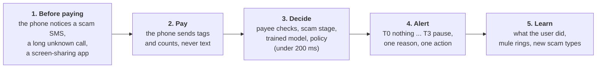

# RUKO (रुको)

RUKO is a scam shield for UPI payments. It watches for the steps of a scam (an unknown call, a "your account will be blocked" message, someone taking control of the screen, small "rewards" followed by bigger and bigger payments) rather than single odd payments. When those steps add up, it pauses the scam, not the payment: the person sees one clear reason in English or Hindi and one thing to do, such as calling a family member or 1930. Everyday payments go straight through with nothing shown. Analysts get a console that explains every decision, finds the mule accounts and rings behind the scams, and spots new scam types as they appear.

It was built for the Amazon AI Cyber Security Hackathon, Track 02: *detect emerging AI-enabled scam workflows in UPI, banking or wallet contexts, and deliver timely, useful alerts without creating alert fatigue*. Everything runs on one Windows laptop with an Android emulator. All the data is synthetic or public; no real money moves. One command starts the whole system:

```powershell
powershell -ExecutionPolicy Bypass -File scripts\dev.ps1
```

With it running, the contract's two example payments give:

```
Meena, on a call with a "police officer" who controls her screen, pays Rs 95,000:  T3  t3_digital_arrest  (30 minute pause)
A kirana purchase by QR:                                                         T0  (nothing shown)
```

## Contents

1. [What this submission claims](#what-this-submission-claims)
2. [How a scam is stopped](#how-a-scam-is-stopped)
3. [Quick start](#quick-start)
4. [What's there after the first start](#whats-there-after-the-first-start)
5. [A guided tour](#a-guided-tour)
6. [Checking the claims yourself](#checking-the-claims-yourself)
7. [What it does, part by part](#what-it-does-part-by-part)
8. [AI-enabled scams](#ai-enabled-scams)
9. [Who can see what](#who-can-see-what)
10. [Known limitations](#known-limitations)
11. [Configuration](#configuration)
12. [Running the parts by hand](#running-the-parts-by-hand)
13. [Tests](#tests)
14. [Troubleshooting](#troubleshooting)
15. [Questions](#questions)
16. [Glossary](#glossary)
17. [Repository layout and other documents](#repository-layout-and-other-documents)

## What this submission claims

| Claim | What RUKO does | How to check it |
| --- | --- | --- |
| **Detects scam workflows, not single payments** | A stage tracker follows each person from "contacted" to "hooked", "under control", "paying" and "paying again". Every payment is judged on four independent kinds of evidence: the situation on the phone, scam messages, the payee, and the person's own behaviour | [Tour step 2](#a-guided-tour), [docs/flows.md](docs/flows.md) |
| **Catches AI-enabled scams** | Video calls from unknown callers (deepfake "officers"), one number calling many people (AI voice at scale), OTPs arriving during a call, scam messages written by AI, the same scam reaching many phones, and bot-scale mule rings | [AI-enabled scams](#ai-enabled-scams), the console's **AI scammer** page |
| **Finds emerging scams** | Payments that matched no known scam type are grouped by how they happened; a growing group appears on **Emerging patterns**. The blue team clusters missed scams, drafts a new scam type with an LLM, and two analysts approve it | [docs/features/emerging-patterns.md](docs/features/emerging-patterns.md), [red_team_blue_team/](red_team_blue_team/README.md) |
| **Timely alerts** | Decisions arrive in under 200 ms, at the moment of payment, before the PIN. Warnings before any payment come from the phone itself (a scam SMS, an OTP during a call, a task-scam pattern) | `logs/decide.jsonl` timings, `backend/tests/test_decide.py` timing tests |
| **Useful alerts** | One main reason in words, in English or Hindi, never a score, plus one action: call your trusted person, call 1930, or wait | [docs/features/alert-screens-and-feedback.md](docs/features/alert-screens-and-feedback.md) |
| **No alert fatigue** | No interruption unless two independent kinds of evidence agree; small payments and known payees are never interrupted; a weak early sign is recorded, not shown; repeated alerts are merged; the console tracks what users did on every alert | [Accuracy](#checking-the-claims-yourself): 0 honest interruptions per 1,000 on the held-out world with the trained model |
| **Private by design** | Message text, call audio, contacts and screen content never leave the phone; only tags and counts do. Users are pseudonyms on the server | [Who can see what](#who-can-see-what) |
| **Never blocks a payment by failing** | If RUKO is slow, down or confused, the payment goes ahead with "safety check unavailable" | `backend/tests/test_decide.py` (fail-open tests) |

All of the tests pass: 375 on the server, 79 for the models, 153 on Android, and 88 for the red team and blue team (see [Tests](#tests)).

## How a scam is stopped



1. **Before any payment**, the phone watches with the user's permission: a new SMS is checked for scam scripts, a bank alert feeds the task-scam watcher, a call that ends is timed, and a screen-sharing app is noticed. Only tags go to the server, and only if "Early warnings" is on.
2. **At Pay**, the phone takes one reading (call, device, recent scam tags, the task-scam summary, how the Pay screen was used, whether the payee is a saved contact, and its own on-phone model's verdict) and sends it to `POST /v1/decide`.
3. **The server decides**: where this person is in a scam, what the payee's bank and the cybercrime lists say about the payee, what the payment graph says (crowd signal, money loops, bot-scale rings), the trained model's score, the closest scam type, and the policy. The answer is a **tier**, from T0 to T4.
4. **The app shows the alert** for that tier, in words. If RUKO doesn't answer in 1 second, the payment goes ahead.
5. **Afterwards**, what the user did (paid anyway, waited, called someone, cancelled) and whether the payment happened go back to the server. Analysts see everything, approve mule suspects, and name new scam types.

| Tier | What the user sees |
| --- | --- |
| T0 | Nothing. Straight to the PIN |
| T1 | A short tip on the PIN screen |
| T2 | A card with the main reason; it must stay on screen for 5 seconds before "slide to pay" works |
| T3 | A full pause with a 30 minute countdown: call your trusted person, call 1930, wait with a reminder, or "I know this person" |
| T4 | "Your bank is checking this payment" |
| No answer | "Safety check unavailable"; the user can still pay |

Words in bold are in the [Glossary](#glossary). Drawings of the whole system are in [docs/diagrams/](docs/diagrams/): how RUKO protects a payment, how the server decides, the SDK inside Cache Pay, and the red team and blue team.

## Quick start

**You need** Windows with PowerShell, Python 3.11, Node.js 18 or newer (for the console), and Android Studio with an emulator (the scripts expect the AVD `Medium_Phone_API_37.0`, but any recent one works). The first start downloads Python and npm packages, so it needs the internet; later starts don't. Keep the repository outside OneDrive or other synced folders: they lock files and break the Gradle build.

1. **Get the code:**

   ```bash
   git clone https://github.com/manusingh090/ruko_01.git
   cd ruko_01
   ```

2. **Start the emulator** from Android Studio's Device Manager, so the start script finds it.

3. **Start everything.** The first time this creates `.venv`, installs packages, generates the synthetic world (a minute or two) and builds the console:

   ```powershell
   powershell -ExecutionPolicy Bypass -File scripts\dev.ps1
   ```

   On macOS or Linux, use `sh scripts/dev.sh`.

4. **Wait for** `Ready.` in the output. It also prints the address of the console, normally <http://127.0.0.1:8000/console/>. If port 8000 was taken, the API moves to the next free port (it says which) and the phone is pointed there automatically.

5. **Install the app.** In Android Studio, open the `android/` folder and press **Run** (Cache Pay). On the first launch, choose **Use a demo account** and pick Meena Kulkarni (or sign up with any details, which also speaks for Meena), then choose a 6 digit passcode.

6. **Stop it** with:

   ```powershell
   powershell -ExecutionPolicy Bypass -File scripts\dev.ps1 -Stop
   ```

| To... | Run |
| --- | --- |
| Start again after `git pull` (rebuilds the console if it changed) | `scripts\dev.ps1` |
| Rebuild the synthetic world from scratch | `scripts\dev.ps1 -Regenerate` |
| Skip the task-scam bait account | `scripts\dev.ps1 -NoBait` |
| Force a console rebuild | `scripts\dev.ps1 -BuildConsole` |
| Use other ports | `scripts\dev.ps1 -ApiPort 8100 -IntelPort 8101` |
| Check it's healthy | <http://127.0.0.1:8000/health> answers `"status": "ok"` with the scorer and contract versions |
| Read the logs | `logs\api.log`, `logs\api.err.log`, `logs\intel.log` |

## What's there after the first start

**A synthetic world** in `data/`, built by the simulator: 2,000 people over 30 days, 72,594 payments, 23 scam journeys of six types, 3,098 bank accounts including mules, and 720 complaints to the cybercrime lists. Each piece of the world has a realistic delay: a mule is reported days after it starts, and listed later still.

**Services:**

| Service | Address | What it is |
| --- | --- | --- |
| Risk API | <http://127.0.0.1:8000> | The engine that decides every payment |
| Analyst console | <http://127.0.0.1:8000/console/> | The web app for fraud analysts, served by the API |
| Mock intel | <http://127.0.0.1:8001> | Stand-ins for NPCI, the banks, DoT's Fraud Risk Indicator and the I4C suspect registry |

**Demo data**, so nothing starts empty:

* The demo mule `secure.settlement.desk@okaxis` has just received money from 40 strangers and forwarded nearly all of it on.
* A bait account has sent ₹150 "rewards" to 40 RUKO users, so the payment graph sees a crowd.
* Scripted demo users have already paid through every scam type, so the console's Alerts, Transactions, Suspects, Scam rings and Emerging patterns pages have something to show within about 30 seconds.

**On the emulator:** the demo users' contacts are in the phone's address book. The app speaks for one simulated person, so the server has their history: Meena by default, or Rahul if he's chosen under **Use a demo account**.

| Demo identity | What it is |
| --- | --- |
| `u_demo_meena` | Meena Kulkarni, Pune, 60+, the main demo user. Contacts: Sai Das, Aarav Yadav, Rahul Kumar, Aarav Mishra (paid before), Arjun Pandey (sends her money), Kiran Sinha, Sunil Yadav, Nikhil Singh (never paid) |
| `u_001435` | Rahul Yadav, Bengaluru, a second demo user (also used by the scam lab) |
| `secure.settlement.desk@okaxis` | The demo mule |
| `shreeganesh.kirana@okaxis` | Meena's usual grocery shop |

## A guided tour

**As the person paying (Cache Pay on the emulator):**

1. In **Profile**, switch on every Scam Shield switch (call signals, app checks, session checks, SMS scam check, watch my money alerts, share suspicious accounts, early warnings) and allow the permissions Android asks for.
2. **An everyday payment.** Choose **To Bank & Self A/c**, pay `shreeganesh.kirana@okaxis` ₹150. It goes straight to the PIN: nothing shown.
3. **A digital arrest.** Ring the emulator from an unknown number and answer it:

   ```bash
   adb emu gsm call 9812345670
   adb emu gsm accept 9812345670
   ```

   Long-press **Cache Pay** on Home to open the debug panel and set `remote_access_app` to Yes (the emulator can't really be screen-shared). Then pay `secure.settlement.desk@okaxis` ₹95,000 and answer "Who are you paying?" with **Government**. RUKO pauses the payment (T3) and names the scam.
4. On the pause, tap **I know this person**. The server refuses, because the payee looks like a mule, so the pause stays. Tap **Call 1930**, then **Cancel**. End the call with `adb emu gsm cancel 9812345670`.
5. **A scam message.** Send one:

   ```bash
   adb emu sms send 9876543210 "Your KYC is pending, your account will be blocked today. Install the app from this link to update."
   ```

   A notification says "This message may be a scam" and names the type. Tapping it opens **Message check**.
6. **A task scam.** In the debug panel, press **Simulate bait credit** twice and **Simulate outgoing debit** three times. The watcher sees small rewards in and bigger payments out, and the Alerts screen shows the task-scam warning.
7. Open **History** (bottom bar) to see every payment, what RUKO thought it looked like, and what happened.

**As an analyst (the console):** open <http://127.0.0.1:8000/console/>.

1. **Overview** shows alert health (what users did on alerts), scams spreading right now across phones, and a **Run scenario** button that replays every scam type.
2. **Transactions**, then the ₹95,000 payment: the explanation shows every score, every reason with its inputs, each scam type that was checked, the policy's steps and the sources.
3. **Suspects** lists accounts the payment graph links to scams. Approve one as two different analysts, and from then on paying it counts as evidence.
4. **Scam rings** groups the suspects, with the hub accounts the money flows through and the bot-scale tag.
5. **Emerging patterns** shows groups of flagged payments that matched no known scam type. Name one to draft a new scam type.
6. **Explore** draws any UPI ID's money flow: who sent "rewards", which users, who they paid, and where the money went next, with the loop back in red.
7. **Accuracy** shows held-out results: what was caught, false alarms, misses, and named weak spots.

**As the scammer (the scam lab):** open **AI scammer** in the console (`/console/#/lab`). Send an SMS or ring the emulator from the page, or run a ready-made scam (scam call and message, an everyday payment, the same scam on many phones, a new scam with no known type, an OTP during a call). The person on the emulator pays as normal, and the page shows "Did your scam work?".

**As a program:** every decision is one HTTP call:

```bash
curl -X POST http://127.0.0.1:8000/v1/decide -H "content-type: application/json" -d @contracts/examples/decide_request_meena.json
```

## Checking the claims yourself

1. **Run the tests** ([Tests](#tests)). The contract tests run the same example files on the server and on Android, so the two can't drift apart.
2. **Run every scam type through the real API:**

   ```powershell
   $env:PYTHONPATH="backend;ml;data"; $env:PYTHONIOENCODING="utf-8"
   .venv\Scripts\python -m demo.agents --api http://127.0.0.1:8000 --intel http://127.0.0.1:8001 --all
   ```

   It prints what RUKO did against what should happen, for digital arrest, deepfake video, fake KYC, trading group, task job, refund QR, fake customer care, honest users, and a hidden scam type with no known name (which should appear on Emerging patterns).
3. **Read the accuracy results**, on the console's **Accuracy** page or in [backend/evalsuite/accuracy_results.json](backend/evalsuite/accuracy_results.json). On `dev_test`, a held-out world of 5,000 people over 60 days never used in training:

   | | Rules (`rules-0.7`) | Trained model |
   | --- | --- | --- |
   | Scam payments interrupted | 85.3% | 96.8% |
   | Scam rupees stopped | 90.6% | 99.1% |
   | Honest payments interrupted, per 1,000 | 6.32 | 0 |
   | Gentle tips on honest payments, per 1,000 | 21.95 | 0 |

   The on-phone message model catches 85% of held-out scam messages (73% in Hindi, 94% in Hinglish) and flags 3.5% of normal ones.
4. **Read the training results**, in [docs/plan-v3.md, Results](docs/plan-v3.md#results-25-oct-2026). On 25 attack scripts no training world contained, the live model with the fused threat interrupts 93.4% of scam payments, against 4.3% for the model before it, at 1.46 and 0.41 honest interruptions per 1,000 in the two test worlds.
5. **Attack it yourself** with the red team's runner, which plays a scam script against the real engine and reports whether it got through:

   ```powershell
   $env:PYTHONPATH="backend;ml;data;synthetic_playbook"
   .venv\Scripts\python -m interface_script run --playbook task_job
   .venv\Scripts\python -m interface_script run-all
   ```

## What it does, part by part

### On the phone (the RUKO SDK inside Cache Pay)

| Part | What it does | Details |
| --- | --- | --- |
| The payment check | One reading at Pay, sent to the server with a 1 second limit; fails open | [docs/flows.md](docs/flows.md) |
| On-phone model | Runs `device_model.json` on everything the phone measured and sends only its verdict: a scam type, a level and three scores | [android/README.md](android/README.md) |
| Scam message check | Every SMS (and, with permission, chat notifications) is scored by the `lure.json` model; a scam script gets a notification; an OTP during a call gets a full warning | [message-check.md](docs/features/message-check.md) |
| Task-scam watcher | Reads bank SMS alerts in the background and spots "small rewards in, bigger payments out" across every UPI app | [task-scam-watcher.md](docs/task-scam-watcher.md) |
| Early warnings | Tags before any payment (a scam message, a long unknown call, a screen-sharing app, an app from outside the store) move the person's scam stage | [early-warnings.md](docs/features/early-warnings.md) |
| Coached-session signs | How the Pay screen was used: stop-start typing, pasting a UPI ID after switching apps, time away | [contracts/README.md](contracts/README.md) |
| Alert screens | T1 tip, T2 card with a 5 second read, T3 pause with trusted person and 1930, T4 review; English and Hindi | [alert-screens-and-feedback.md](docs/features/alert-screens-and-feedback.md) |
| Encrypted storage | Everything kept on the phone is AES-256 encrypted with an Android Keystore key, excluded from backups; "Delete my data" removes the files and the key | [android/README.md](android/README.md) |

### On the server

| Part | What it does | Details |
| --- | --- | --- |
| The decision | Stage tracker, payee checks (150 ms budget, in parallel), features, trained model, scam type, policy, all within 200 ms | [backend/README.md](backend/README.md) |
| The trained model | One LightGBM model per kind of evidence, calibrated, combined, and fused with a step-by-step scam-type search into one threat score | [threat.md](docs/features/threat.md) |
| Scam types | A file of known scam types written as steps; the closest one names the alert | [playbooks.md](docs/features/playbooks.md) |
| Policy | Two independent kinds of evidence before any interruption, amount caps, trusted payees, an alert budget, all numbers in `policy.yaml` | `backend/api/policy.yaml` |
| Payment graph | Who pays whom, built only from what RUKO sees: crowd signals, money loops, bot-scale rings, new accounts spreading fast | [rings-and-hubs.md](docs/features/rings-and-hubs.md), [campaigns.md](docs/features/campaigns.md) |
| Evidence vault | Every decision is written to a hash-chained log, so a changed record is detected | `backend/evidence/store.py` |
| Transaction database | Every decision with all its inputs, scores and outcomes, for the console and for training | [transaction-database.md](docs/features/transaction-database.md) |
| Mock intel | NPCI, banks, DoT and I4C stand-ins, each with its real blind spots and delays | [backend/docs/](backend/docs/) |

### Finding the people behind the scams

| Part | What it does | Details |
| --- | --- | --- |
| Mule discovery | Ranks suspect accounts from the payment graph, groups rings, finds hubs | [rings-and-hubs.md](docs/features/rings-and-hubs.md) |
| Two-person approval | A suspect counts in live decisions only after two different analysts approve it | [rings-and-hubs.md](docs/features/rings-and-hubs.md) |
| Emerging patterns | Groups flagged payments with no known scam type by how they happened; a growing group can be named | [emerging-patterns.md](docs/features/emerging-patterns.md) |
| Red team and blue team | The red team writes scams designed to slip past RUKO; the blue team clusters what got through, has LLM agents draft a new scam type, backtests it, and asks two analysts to approve | [red_team_blue_team/](red_team_blue_team/README.md) |

### The analyst console

Overview, Alerts, Cases, Transactions with a full explanation of each payment, Suspects, Scam rings, Emerging patterns, Explore, AI scammer (the scam lab) and Accuracy. Analysts see every number, including the threat score; users never do. See [console/README.md](console/README.md).

## AI-enabled scams

AI makes scams sound better and run at a larger scale. It doesn't change what the scam needs from the victim: to move money, fast, to an account they've never used, usually while someone guides them. RUKO looks for those steps, and for the marks that scale leaves behind.

| AI-enabled scam | How RUKO spots it | Reason shown |
| --- | --- | --- |
| A deepfake "officer" on a video call | A call over the internet while another app is using the camera, from someone unknown, during a payment | Live call with someone unknown |
| A cloned voice calling thousands of people | The same caller number reported by many different phones | One number calling many people (R14) |
| "Read me the OTP" while on a call | A bank or UPI OTP arriving during a call with an unknown number | OTP during a call (R15) |
| Scam messages written by AI, a new wording each time | The on-phone message model reads what the message asks for, in English, Hindi and Hinglish; it was tested on AI-written messages | Scam message (R5) |
| The same scam sent to many phones | The UPI ID or link in flagged messages, counted across users | Scam spreading now (R13) |
| Chatbot-run task scams | Small rewards in, bigger payments out, seen in the person's own bank alerts | Rewards, then paying more (R10) |
| Bot-scale mule rings | The same amount to or from many people at a steady rhythm | Linked to a scam ring (R11) |
| Someone directing the victim | Stop-start typing, pasting a UPI ID after switching apps, the speaker on | Being guided while paying (R12) |
| Scams nobody has seen yet | Emerging patterns and the blue team's clustering find them from what happened, not from a known name | Named once two analysts approve |

LLMs help people, never the decision: they draft scam-type descriptions and red-team attacks, and an analyst approves what's used. The tier always comes from the trained model, the rules and the policy.

## Who can see what

| Who | Sees | Never sees |
| --- | --- | --- |
| The person paying | The tier in words, the scam type, up to three reasons, what to do | A score or number of any kind, so a scammer holding the phone can't probe it |
| Their phone | Their own messages, calls, contacts, bank alerts and payment history, encrypted | Anything about other users |
| The RUKO server | Tags, counts, the phone's verdict, the payee's UPI ID, and the caller's number only for an incoming call from a number not in contacts | Message text, call audio, contacts, names, screen content |
| Analysts | Every score and reason, payee accounts in plain text, users as pseudonyms | Who a user really is |
| Mule suspects | Count in decisions only after two analysts approve | |

Every Scam Shield switch is off until the user turns it on, except session checks, which send only counts and rounded times from RUKO's own Pay screen. Age, gender and language are never used to decide anything; they are used only to check that false alarms aren't higher for any group.

## Known limitations

* **The world is synthetic, and too easy.** For example, a mule account's age alone separates mules almost perfectly. Real-world gains will be smaller than the numbers here ([data/eval/realism/FINDINGS.md](data/eval/realism/FINDINGS.md)).
* **Scams designed to avoid RUKO still get through.** On the red team's 50 invented attacks (scored with the earlier model), 97% of their payments weren't interrupted: they end the call long before paying, use QR codes, or start with a tiny payment. Hindi scam messages are caught less often (73%) than English (87%).
* **Calls over WhatsApp and other apps** are seen only as "a call over the internet"; the simulator only has phone-network calls, so this isn't measured.
* **SMS reading is for the demo build only.** Play Store doesn't allow SMS permissions for a payment app; the real route is the bank's own transaction feed.
* **No real pause on the money.** The app counts down the pause, but nothing stops the bank from moving the money; that needs the bank or payment app's side.
* Not built yet: T4 review polling, the "looks AI-written" model on the phone, Docker packaging, Redis or Postgres, and a signed release APK.

## Configuration

Most settings are files in the repository, so changing one is a reviewed commit:

| File | What it sets |
| --- | --- |
| `backend/api/policy.yaml` | Tiers, the two-evidence rule, amount caps, trusted payees, the alert budget, crowd and campaign thresholds |
| `contracts/episode_rules.json` | The task-scam watcher's rules, shared by the phone and the server |
| `contracts/watch_rules.json` | Early-warning rules, shared by the phone and the server |
| `data/playbooks/playbooks.yaml` | The known scam types, written as steps |
| `android/local.properties` | `sdk.dir` (your Android SDK) and optionally `API_BASE_URL`; not committed |
| `.env` | `PAYEE_SALT` (copy `.env.example`); never committed |

Start-up options of the API (`python -m api.main`):

| Option | Default | Meaning |
| --- | --- | --- |
| `--port` | 8000 | The API's port |
| `--intel` | `http://127.0.0.1:8001` | Where the mock intel runs |
| `--scorer` | `ml` | `ml` for the trained model, `rules` for the hand-set rules; falls back to rules if the model can't load |
| `--demo-clock` | off | Decide on the synthetic world's clock (needed with a real phone) |
| `--lab` | off | Turn on the scam lab endpoints |
| `--seed-demo` | off | Run the demo users once at start, so the console isn't empty |
| `--db` | in memory | A file such as `logs/ruko.db` to keep the transaction database between runs |

## Running the parts by hand

The start script does all of this; by hand, from the repository root, in PowerShell:

```powershell
python -m venv .venv
.venv\Scripts\python -m pip install -r ml/requirements.txt          # includes the server's packages
$env:PYTHONPATH="backend;ml;data"; $env:PYTHONIOENCODING="utf-8"
.venv\Scripts\python -m sim.generate --users 2000 --days 30 --seed 7 --out data/
.venv\Scripts\python -m intel_mock.app --data data --port 8001                       # in one window
.venv\Scripts\python -m api.main --data data --port 8000 --demo-clock --lab --seed-demo   # in another
.venv\Scripts\python -m sim.mule_pump --payers 40
.venv\Scripts\python -m sim.bait_pump --api http://127.0.0.1:8000
adb reverse tcp:8000 tcp:8000
```

In Git Bash or on macOS and Linux, use `export PYTHONPATH="backend:ml:data"` and `.venv/bin/` (Git Bash: `.venv/Scripts/`). Use `127.0.0.1` rather than `localhost` between the services on Windows: `localhost` tries IPv6 first and adds about 200 ms.

The console for development: `cd console`, `npm install`, `npm run dev`, then <http://localhost:5173/console/>.

## Tests

```powershell
$env:PYTHONPATH="backend;ml;data"; $env:PYTHONIOENCODING="utf-8"
.venv\Scripts\python -m pytest backend/tests -q      # 375 server tests
.venv\Scripts\python -m pytest ml/tests -q           # 79 model tests
```

```bash
cd android
JAVA_HOME="/c/Program Files/Android/Android Studio/jbr" sh ./gradlew assembleDebug testDebugUnitTest   # 153 tests: 132 SDK, 21 app
```

Android needs Android Studio's bundled Java (Java 25); an older system Java won't build it. The Kotlin tests read `contracts/` and `ml/model/artifacts/` from the repository, so a contract change or a retrained model that the app doesn't match fails a test rather than the demo.

The red team's runner and the blue team have their own tests, 11 and 77 (add `synthetic_playbook` and `red_team_blue_team` to `PYTHONPATH`): `pytest synthetic_playbook/interface_script/tests` and `pytest red_team_blue_team/blue_team/tests`.

## Troubleshooting

| Symptom | Fix |
| --- | --- |
| Every payment says "Safety check unavailable" | The phone can't reach the laptop. Start the emulator first, then run `scripts\dev.ps1` again (it sets up `adb reverse`) |
| "port is already in use" or the API isn't on 8000 | The script moves to the next free port and says which; open the console on that port |
| `running scripts is disabled on this system` | Run it as shown, with `powershell -ExecutionPolicy Bypass -File scripts\dev.ps1` |
| The Android build fails with a Java error | Build with Android Studio, or set `JAVA_HOME` to Android Studio's `jbr` folder |
| Gradle "Unable to delete directory" | The project is in OneDrive or another synced folder. Move it out, for example to `C:\dev\ruko_01` |
| The console page is blank | Node.js is missing or the build failed; install Node 18+ and run `scripts\dev.ps1 -BuildConsole` |
| A Python `UnicodeEncodeError` about ₹ | Set `$env:PYTHONIOENCODING="utf-8"` |
| The scam lab says no emulator | Start the emulator, then restart the stack |
| The digital arrest shows less than T3 | A busy laptop can make a payee check miss its 150 ms budget. Try again; the answer is cached for 30 minutes |
| No scam notifications | Allow notifications for Cache Pay, and switch on SMS scam check in Profile |

## Questions

**Does any real money move?** No. Cache Pay is a demo app; the PIN screen and the banks are simulated.

**Does RUKO read my messages?** On the phone only. The text is scored there and thrown away; only a tag such as "fake KYC" is sent, and only with the switch on.

**Why doesn't the app show a risk score?** A scammer holding the victim's phone could watch the score and adjust. Users see words; analysts see the numbers.

**Is an LLM deciding whether my payment is stopped?** No. LLMs only draft text for people to check: descriptions of new scam types and test attacks. The decision comes from the trained model, the rules and the policy.

**Where is the data?** The synthetic world is in `data/*.parquet` (not in git; rebuilt by the start script). The server keeps its transaction database in memory unless started with `--db`. The phone keeps its data encrypted in the app's private storage.

**What if the server is down?** The payment goes ahead with "Safety check unavailable". RUKO never blocks someone's money because it failed.

**Can another payment app use RUKO?** Yes. The detection ships as an Android library, `android/ruko-sdk/`; Cache Pay is its first host app. See [android/README.md](android/README.md).

## Glossary

| Word | Means |
| --- | --- |
| **Tier** | How strongly RUKO reacts to a payment: T0 nothing, T1 a tip, T2 a card, T3 a pause, T4 bank review |
| **Scam stage** | How far a person is into a scam: S1 contacted, S2 hooked, S3 under control, S4 paying, S5 paying again |
| **Kind of evidence (family)** | One of four independent groups: C the situation (calls, screen control), L scam messages, P the payee, B the person's own behaviour. An interruption needs two |
| **Mule** | A bank account that receives scam money and passes it on |
| **Payment graph** | RUKO's map of who paid whom, built only from what it saw |
| **Crowd signal** | Many unrelated RUKO users paying, or being paid by, the same new account |
| **Money loop** | The account a victim pays forwards money back to where their "rewards" came from |
| **Scam type (playbook)** | A known kind of scam, written as steps, used to name an alert |
| **Emerging pattern** | A growing group of flagged payments that matched no known scam type |
| **Task-scam episode** | The phone's record of small rewards in followed by bigger payments out |
| **Threat score** | The server's 0 to 100 number for a payment; analysts see it, users never do |
| **Fail open** | When RUKO can't decide in time, the payment goes ahead |
| **Contract** | The exact shape of what the phone and server send each other (`contracts/`) |
| **Mock intel** | Stand-ins for NPCI, banks, DoT and I4C, with their real delays and gaps |
| **Red team, blue team** | People and tools that attack RUKO, and those that learn from what got through |
| **Scam lab** | The console page where a judge plays the scammer against the emulator |
| **SDK** | The RUKO library a payment app adds to get the shield |

## Repository layout and other documents

```
README.md                 this file
CLAUDE.md                 the team's rules, the contract and a map of the code
android/                  the phone
  ruko-sdk/                 the RUKO SDK: signals, models, watcher, alerts' data, server client
  app/                      Cache Pay, the demo payment app that hosts the SDK
backend/                  the server
  api/                      the decision, policy, payee checks, threat, feedback, explanations
  features/                 the features, stage tracker, episode and session logic
  graph/                    the payment graph, mule discovery, campaigns
  intel_mock/               NPCI, banks, DoT and I4C stand-ins
  evidence/ store/          the hash-chained evidence vault and the transaction database
  demo/ evalsuite/          demo users, the scam lab, the accuracy suite
  schema/                   the contract's source of truth
  tests/                    375 tests
console/                  the analyst console (React and TypeScript)
contracts/                the published contract, JSON schemas, shared examples and rules
ml/                       training, the server and on-phone models, the message model
data/                     the simulator, the playbooks file, evaluations
red_team_blue_team/       attacks on RUKO, and the agents that learn from them
synthetic_playbook/       the runner that plays an attack script against the real engine
scripts/                  dev.ps1 and dev.sh, the one-command start
docs/                     flows, one page per feature, plans, diagrams
```

* [CLAUDE.md](CLAUDE.md): the rules every change follows, the contract version by version, how the scorer is chosen, and a map of every module.
* [docs/flows.md](docs/flows.md): what happens, in order, before a payment, during one and after.
* [docs/features/](docs/features/README.md): one page per feature, with how to try it.
* [docs/testing-on-device.md](docs/testing-on-device.md): a checklist for trying every app feature on the emulator.
* [contracts/README.md](contracts/README.md): every field the phone and server exchange, and the changelog.
* [docs/plan-v3.md](docs/plan-v3.md): how the current model was built, and its results.
* [docs/security-hardening.md](docs/security-hardening.md): our own red-team audit and what was fixed.
* [red_team_blue_team/README.md](red_team_blue_team/README.md): the attack and learning loop.
* [android/README.md](android/README.md), [backend/README.md](backend/README.md), [console/README.md](console/README.md), [ml/README.md](ml/README.md), [data/README.md](data/README.md): each part in detail.
